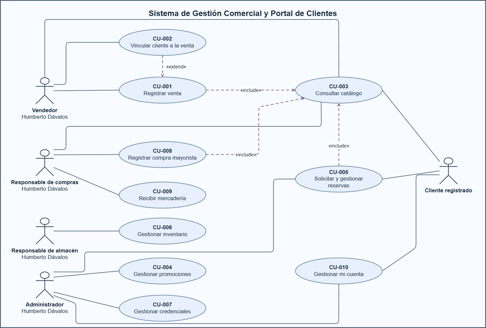

Humberto Dávalos desempeña los cuatro roles internos; el cliente registrado utiliza el portal.

| ID | Caso de uso | Actor | Requisitos relacionados |
|---|---|---|---|
| CU-001 | Registrar venta | Vendedor | RF-001; utiliza RF-007 y, cuando el comprador se identifica, RF-010 |
| CU-002 | Vincular cliente a la venta | Vendedor | RF-010 |
| CU-003 | Consultar catálogo | Cliente registrado, Vendedor y Responsable de compras | RF-007 |
| CU-004 | Gestionar promociones | Administrador | RF-008 |
| CU-005 | Solicitar y gestionar reservas | Cliente registrado y Administrador | RF-007, RF-009 |
| CU-006 | Gestionar inventario | Responsable de almacén | RF-002, RF-015, RF-016 |
| CU-007 | Gestionar credenciales | Administrador | RF-013, RF-019 |
| CU-008 | Registrar compra mayorista | Responsable de compras | RF-003, RF-004, RF-007 |
| CU-009 | Recibir mercadería | Responsable de compras | RF-004, RF-005 |
| CU-010 | Gestionar mi cuenta | Administrador y Cliente registrado | RF-014, RF-017, RF-018, RF-019 |

[Diagrama editable de casos de uso](../modelos/casos-de-uso.drawio).

## CU-001: Registrar venta

Actor: Vendedor, rol desempeñado por Humberto Dávalos.

Precondiciones: Humberto tiene una sesión administrativa activa. Los productos están activos y cuentan con precio y stock registrados.

### Flujo principal

1. Humberto consulta el catálogo mediante CU-003 y selecciona los productos y cantidades de la venta.
2. El sistema comprueba que la venta tenga productos, que las cantidades sean positivas y que exista stock suficiente.
3. Si el comprador se identifica como cliente registrado, Humberto lo vincula mediante CU-002. En caso contrario, continúa sin cliente asociado.
4. Humberto elige efectivo, Yape, Plin u otras billeteras digitales. El sistema calcula el total con los precios del servicio y muestra los campos del método elegido.
5. Humberto ingresa el monto recibido. Si elige un medio digital, comprueba el abono y marca la confirmación manual.
6. El sistema valida el monto. Si el administrador seleccionó un beneficio del cliente, la API valida su disponibilidad y el mínimo de compra antes de aplicar el descuento. Para pagos digitales, exige que coincida con el total a dos decimales y que Humberto haya confirmado la comprobación. Para efectivo, calcula el vuelto cuando corresponde.
7. El sistema guarda la cabecera y el detalle de la venta, registra la salida de inventario y descuenta el stock en una misma transacción.
8. El sistema confirma el guardado y muestra el identificador de la venta.

### Alternativas y excepciones

| Situación | Respuesta |
|---|---|
| El comprador no se identifica como cliente registrado | Continuar sin vincular una cuenta. |
| El monto recibido en efectivo supera el total | Calcular y mostrar el vuelto. |
| La venta corresponde al recojo de un apartado | Abrir Caja con el cliente y las líneas del apartado. Confirmar la venta y cerrar el apartado en la misma transacción. |
| Se elige pago digital | Mostrar el panel con un QR común. Elegir la billetera, registrar el importe exacto y confirmar manualmente el abono. |
| La venta está vacía o contiene cantidades no válidas | Solicitar la corrección antes de continuar. |
| Un producto no tiene stock suficiente | Identificar el producto y rechazar el intento actual. Humberto puede iniciar una nueva selección. |
| El monto recibido no es válido o falta comprobar el abono digital | Solicitar la corrección antes de guardar. |
| Falla el guardado | Revertir la transacción y mostrar que la venta no fue confirmada. |

Postcondición de éxito: quedan guardados la venta, su detalle y el movimiento de salida, con el stock actualizado.

Postcondición ante fallo de guardado: no quedan una venta parcial ni descuentos de stock correspondientes a una venta sin confirmar.

CU-001 incluye CU-003. CU-002 extiende CU-001 cuando el comprador se identifica como cliente registrado.

## CU-002: Vincular cliente a la venta

Actor: Vendedor, rol desempeñado por Humberto Dávalos.

Requisito relacionado: RF-010.

Relación: extiende CU-001 cuando el comprador se identifica como cliente registrado. La vinculación es opcional y no impide guardar la venta.

Precondiciones: Humberto tiene una sesión administrativa activa y una venta en curso en CU-001. El comprador se identifica como cliente registrado.

### Flujo principal
1. Humberto busca al cliente registrado con los datos que proporciona el comprador.
2. El sistema muestra el cliente que coincide.
3. Humberto confirma que es el cliente indicado por el comprador.
4. El sistema asocia el cliente a la venta en curso.
5. El sistema devuelve el control a CU-001, que continúa con la elección del método de pago.

### Alternativas y excepciones

| Situación | Respuesta |
|---|---|
| El comprador no se identifica | CU-002 no se ejecuta. La venta continúa sin cliente asociado. |
| El sistema no encuentra un cliente registrado con los datos indicados | Humberto repite la búsqueda o continúa la venta sin cliente asociado. |

Postcondición de éxito: la venta en curso queda asociada a un cliente registrado. La vinculación no modifica los productos, el total ni el método de pago.

Postcondición sin vinculación: la venta continúa sin cliente asociado y puede confirmarse.

## CU-003: Consultar catálogo

Actores: Cliente registrado, Vendedor y Responsable de compras.

Requisito relacionado: RF-007.

Relación: CU-001, CU-005 y CU-008 incluyen CU-003.

Precondiciones: hay productos registrados. Para guardar favoritos y listas, el cliente registrado tiene una sesión iniciada en el portal.

### Flujo principal
1. El actor ingresa el nombre del producto, elige una categoría, o ambos.
2. El sistema busca los productos que coinciden.
3. El sistema muestra cada coincidencia con su nombre, precio y disponibilidad.
4. El cliente registrado guarda un producto en favoritos o en una lista.
5. El sistema conserva la selección en el portal del cliente.

### Alternativas y excepciones

| Situación | Respuesta |
|---|---|
| La búsqueda no tiene coincidencias | El sistema indica que no se encontraron productos. |
| El actor es el Vendedor o el Responsable de compras | Consulta precio y disponibilidad. Los favoritos y las listas pertenecen al portal del cliente registrado. |
| CU-001 invoca la consulta | Humberto elige los productos y cantidades de la venta desde los resultados. |

Postcondición de éxito: el actor ve los resultados con precio y disponibilidad. Si el cliente registrado guardó favoritos o listas, quedan conservados.

## CU-004: Gestionar promociones

Actor: Administrador, rol desempeñado por Humberto Dávalos.

Requisito relacionado: RF-008.

Precondiciones: sesión administrativa activa y producto existente.

### Flujo principal

1. Humberto selecciona el producto que tendrá la promoción.
2. Indica el tipo de descuento, porcentual o fijo, y su valor.
3. Define el inicio, el fin y el estado de la campaña.
4. El sistema calcula el precio resultante y comprueba las fechas.
5. El sistema guarda la campaña y la muestra en el listado correspondiente.

### Alternativas y excepciones

| Situación | Respuesta |
|---|---|
| Se edita una campaña existente | Conservar su identificador al guardar los cambios. |
| Humberto pausa, activa o elimina una campaña | Actualizar su estado o retirarla según la operación elegida. |
| El porcentaje supera 100 o el valor no es positivo | Rechazar el dato y solicitar corrección. |
| La fecha final es anterior a la inicial | Solicitar corregir la vigencia. |
| Faltan el producto o campos obligatorios | Impedir el guardado. |

Postcondición de éxito: la campaña conserva el tipo, el valor, la vigencia y el estado registrados. El precio promocional no puede ser negativo; el cálculo aplicado en la venta debe coincidir entre la interfaz y el servicio.

## CU-005: Solicitar y gestionar reservas

Actor: Cliente registrado.

Requisitos relacionados: RF-007 y RF-009.

Relación: incluye CU-003.

Precondiciones: sesión del cliente en el portal y productos disponibles para consultar en el catálogo.

### Flujo principal

1. El cliente ejecuta CU-003 y selecciona los productos de su solicitud.
2. El sistema calcula el importe estimado.
3. El cliente solicita la separación.
4. El sistema registra la solicitud, genera un código de recojo y muestra el estado pendiente de confirmación.
5. La atención en tienda permite comprobar la disponibilidad y concretar la venta mediante CU-001.

### Alternativas y excepciones

| Situación | Respuesta |
|---|---|
| El cliente modifica la selección antes de enviarla | Actualizar la lista y su importe estimado. |
| Se intenta superar tres productos distintos | Impedir añadir el excedente. |
| Un producto está agotado al confirmar la disponibilidad | Informar el cambio y ajustar la solicitud. |
| El código generado coincide con otro registrado | Generar un código diferente. |

Postcondición de éxito: queda registrada una solicitud con sus productos, importe estimado, código y estado. La especificación contempla hasta tres productos distintos y una vigencia de 24 horas. La solicitud pendiente no aparta unidades. El administrador vuelve a comprobar disponibilidad al confirmar. Un apartado confirmado reduce el stock disponible para otras ventas hasta su cancelación, vencimiento o recojo. Editar devuelve la solicitud a pendiente. El recojo se completa con CU-001.

## CU-006: Gestionar inventario

Actor: Responsable de almacén, rol desempeñado por Humberto Dávalos.

Requisitos relacionados: RF-002 y RF-015.

Relación: Humberto usa las alertas de inventario para decidir qué registrar en Compras.

Precondiciones: Humberto tiene una sesión administrativa activa con acceso autorizado para el mantenimiento de productos y los ajustes de existencias. El stock inicial corresponde al conteo de productos.

### Flujo principal

1. Humberto consulta los productos y sus existencias.
2. El sistema muestra el stock y el mínimo configurado y señala los productos activos cuyo stock es menor o igual al mínimo.
3. Humberto elige consultar el historial, mantener un producto, realizar un ajuste manual o iniciar la reposición cuando corresponda.
4. Para un ajuste manual, Humberto indica el cambio de existencias y su motivo.
5. El sistema comprueba que el motivo contenga al menos un carácter distinto de espacios, que la cantidad sea válida y que el stock resultante no sea negativo.
6. El sistema guarda el ajuste y su motivo en el historial y actualiza el stock en una misma transacción.
7. El sistema confirma el ajuste. Humberto consulta el historial, que muestra sus motivos y conserva los registros anteriores.

### Alternativas y excepciones

| Situación | Respuesta |
|---|---|
| Humberto solo consulta existencias o historial | Mostrar la información sin modificar el stock. |
| Humberto mantiene un producto | Registrar o editar datos, precio y foto opcional. El stock inicial se registra en el alta. |
| Humberto archiva o restaura un producto | El archivo exige resolver reservas vigentes y órdenes pendientes y pausa las campañas activas o programadas. Restaurar habilita el producto. |
| Humberto solicita la baja de un producto | Escribir ELIMINAR y confirmar el stock observado. El sistema comprueba que no haya reservas vigentes u órdenes pendientes, pone el saldo en cero, conserva el historial y finaliza las campañas. |
| El ajuste afecta unidades apartadas | Rechazar el intento y conservar el stock y el historial. |
| El stock de un producto activo es igual al mínimo configurado | Mostrar la alerta para que Humberto evalúe la reposición. |
| Humberto ya compró mercadería para reponer stock | Abrir el módulo Compras y registrar el ingreso directo con CU-008. |
| Un producto inactivo tiene stock menor o igual al mínimo | No incluirlo en la alerta. |
| El usuario no tiene acceso autorizado | Rechazar la operación sin guardar cambios. |
| El motivo está vacío o contiene únicamente espacios | Solicitar corregirlo; el stock permanece sin cambios y no se registra el ajuste. |
| La cantidad no es válida o produciría un stock negativo | Rechazar el ajuste sin modificar existencias. |
| Falla el guardado del ajuste, su motivo o el stock | Revertir la transacción; el stock y el historial conservan el estado anterior al intento. |

Postcondición de éxito: la consulta refleja las existencias; las modificaciones autorizadas quedan guardadas. Cada ajuste manual conserva su motivo en el historial, junto con los ajustes anteriores.

La exigencia del motivo corresponde a los ajustes manuales. Las salidas por ventas siguen CU-001 y las entradas por recepción siguen CU-009.

El [proceso crítico](proceso-critico.md) presenta el flujo de CU-006 y sus controles.

## CU-007: Gestionar credenciales

1. El administrador abre Configuración y consulta los perfiles.
2. Registra o edita una cuenta, incluida la información de contacto opcional. También puede suspender o reactivar accesos autorizados.
3. La cuenta principal puede crear otros administradores, editar sus credenciales y cambiar roles. El sistema protege el rol y acceso de la cuenta principal.
4. Para retirar un acceso autorizado, el administrador confirma la operación. El sistema verifica reservas vigentes del cliente, bloquea el acceso y conserva los registros comerciales vinculados.

**Excepciones.** Un rol insuficiente o un perfil protegido impiden el retiro. Si el proveedor de identidad falla tras bloquear el acceso, queda pendiente completar el retiro.

## CU-008: Registrar compra mayorista

Actor principal: Responsable de compras.

Precondiciones: sesión administrativa y mercadería recibida. El administrador tiene los datos del proveedor y la referencia de recepción.

### Flujo principal

1. Humberto abre Compras y selecciona «Registrar compra».
2. Ingresa razón social, RUC y teléfono. Agrega productos, cantidades y costos unitarios.
3. Ingresa la referencia y selecciona «Guardar compra e ingresar al inventario».
4. La API guarda la compra, la recepción, los movimientos y el stock en una transacción. El sistema muestra la compra como recibida.

### Alternativas

| Situación | Comportamiento |
|---|---|
| El producto aún no existe | Crearlo desde la línea con stock inicial cero y continuar el formulario de compra. |
| La referencia es inválida o la recepción falla | Mostrar el error y conservar las existencias previas al intento. |
| Se crea una orden pendiente mediante la API | Guardar proveedor, detalle y total estimado. La orden queda disponible para recepción en CU-009. |

## CU-009: Recibir mercadería

Actor: Responsable de compras, rol desempeñado por Humberto Dávalos.

Requisitos relacionados: RF-004 y RF-005.

Precondiciones: sesión administrativa activa, orden pendiente con saldo por recibir, mercadería verificada físicamente y referencia de recepción no utilizada.

### Flujo principal

1. Humberto selecciona la orden pendiente correspondiente a la entrega.
2. Compara los productos y cantidades con la mercadería recibida.
3. Registra las cantidades efectivamente recibidas.
4. El sistema incrementa el stock y registra un movimiento de entrada por producto en una misma transacción.
5. El sistema acumula las cantidades recibidas, actualiza el saldo, el costo unitario ponderado y las alertas, y conserva la orden pendiente o la marca recibida según corresponda.

### Alternativas y excepciones

| Situación | Respuesta |
|---|---|
| La entrega es menor que el saldo por recibir | Conservar la orden pendiente con la diferencia restante. |
| Se anula una orden sin recepciones registradas | Marcarla anulada sin modificar existencias. |
| La cantidad recibida supera el saldo de la orden | Rechazar y solicitar corrección. |
| La orden está recibida o anulada, o la referencia ya se utilizó | Impedir una entrada duplicada. |
| Falla el guardado de la recepción | Revertir las cantidades y movimientos de la operación. |

Postcondición de éxito: queda guardada una recepción sin duplicados y el stock aumenta por lo efectivamente recibido. La orden permanece pendiente si hay saldo o queda recibida cuando se completa. Una orden con entradas registradas no se anula; las devoluciones y la reversión de recepciones quedan fuera de este alcance.

## CU-010: Gestionar mi cuenta

1. El cliente abre Mi cuenta o el administrador entra en Configuración y Seguridad.
2. El titular puede guardar, cambiar o quitar el teléfono. Para cambiar la contraseña, verifica la actual e ingresa la nueva con su confirmación.
3. El titular no protegido puede retirar su acceso. Debe verificar su contraseña y escribir ELIMINAR. Las reservas vigentes bloquean el retiro de un cliente.
4. El cliente también consulta su contacto, historial y puntos. Puede reclamar o cancelar un beneficio disponible. El canje se realiza en Caja con CU-001 y queda vinculado a la venta.
