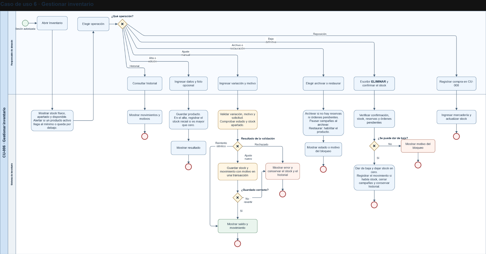

# CU-006 · Gestionar inventario

[Diagrama editable](../modelos/actividad-gestionar-inventario.drawio) · [XML](../modelos/actividad-gestionar-inventario.xml)

El responsable de almacén, con una sesión administrativa, consulta el stock físico, apartado y disponible, y puede filtrar alertas de productos activos cuyo saldo físico es menor o igual al mínimo. Desde el producto puede consultar su historial, registrar un ajuste o gestionar su estado.

- **Alta y edición.** El alta puede registrar una entrada inicial. Editar los datos de un producto no ajusta el stock. La foto es opcional.
- **Ajuste.** El servicio valida la variación, el motivo y el identificador de solicitud. El saldo debe cubrir los apartados. El saldo, el motivo y el movimiento se confirman en una sola transacción. Un reintento idéntico devuelve el movimiento registrado.
- **Archivo y baja.** Ambos requieren resolver las reservas vigentes y las órdenes pendientes del producto. Archivar desactiva el producto y pausa las campañas activas o programadas. Restaurar vuelve a habilitar el producto. Para darlo de baja se debe confirmar la palabra ELIMINAR y el stock observado. Si hay stock, el servicio registra la variación a cero y termina las campañas.

[Servicio de inventario](../codigo/backend/src/services/inventoryService.js) · [Pruebas de inventario](../codigo/backend/test/inventory.test.js) · [Trazabilidad](../matrices/trazabilidad.md)
