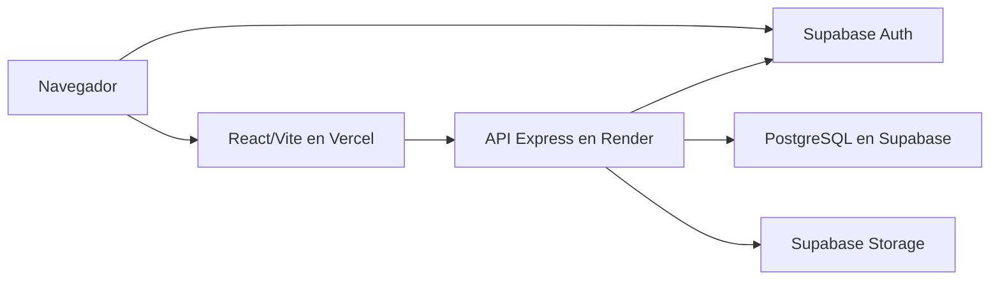
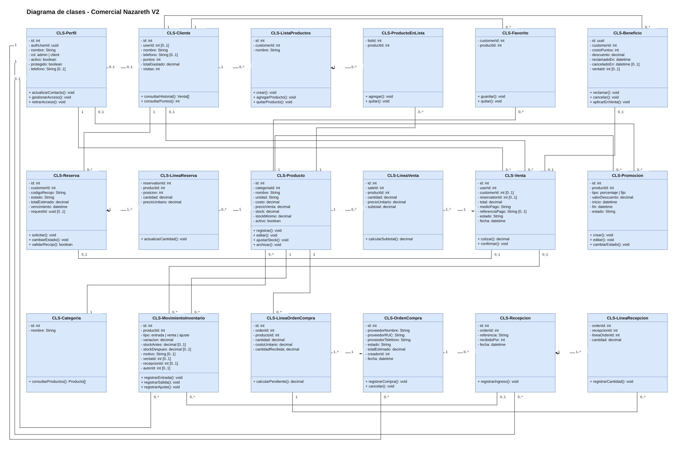
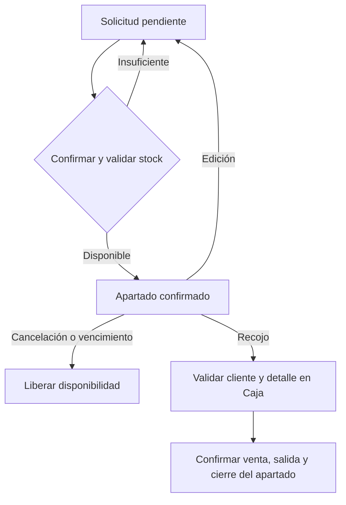
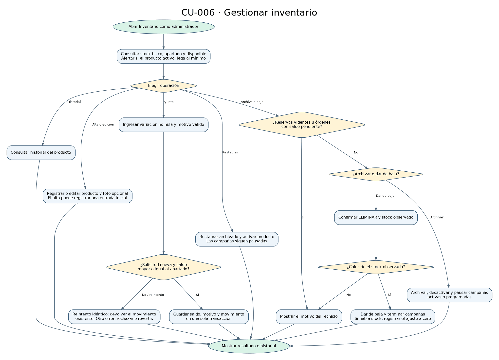
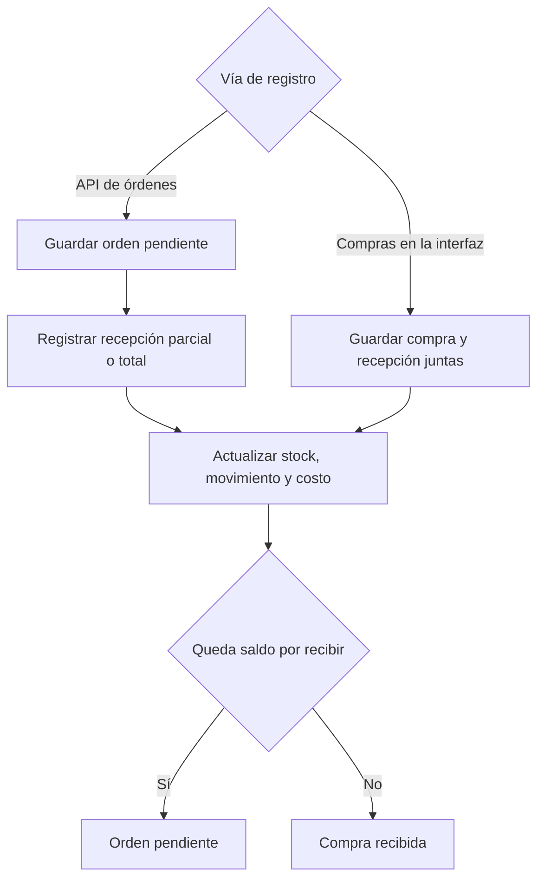

# Modelos de Comercial Nazareth V2

Los modelos describen los módulos, servicios y entidades del sistema. El modelo de clases representa las entidades del dominio y sus relaciones según el esquema y los servicios.

## Despliegue

El navegador inicia sesión en Supabase Auth. Express valida la identidad y el rol de cada operación protegida y usa PostgreSQL para las operaciones comerciales. El servicio de fotos usa Storage.

La aplicación web se publica en [Vercel](https://comercial-nazareth-codigo.vercel.app/) y la API Express se aloja en Render. La dirección de la API se configura en el frontend mediante `VITE_API_URL`; el backend limita los orígenes admitidos con `CLIENT_ORIGIN`. PostgreSQL conserva los registros comerciales, Supabase Auth administra la identidad y Storage almacena las fotos de productos.

El diagrama muestra la distribución del sistema y las conexiones entre servicios. La [guía técnica](../codigo/GUIA-TECNICA.md#despliegue-web) describe su configuración y el [informe de verificación](../reportes/verificacion-v2.md) registra las pruebas del sistema.

## Casos de uso por rol

Humberto Dávalos desempeña los roles de vendedor, administrador, responsable de almacén y responsable de compras con una sesión administrativa. El cliente registrado usa su propio perfil. [Diagrama editable](casos-de-uso.drawio) · [Detalle de casos de uso](../docs/CU.md).

## Clases del dominio

[Diagrama editable en Draw.io](clases.drawio) · [Esquema comercial](../codigo/database/migrations/001_commercial_schema.sql) · [Relación entre reservas y ventas](../codigo/database/migrations/005_full_scope.sql) · [Beneficios de fidelización](../codigo/database/migrations/013_loyalty_benefits.sql).

El diagrama reúne las 18 entidades principales del dominio. **Producto** conecta ventas, inventario, compras, reservas y catálogo. Las multiplicidades y vínculos corresponden al esquema relacional. Las operaciones representan responsabilidades del dominio realizadas por los servicios de Express; no son necesariamente métodos JavaScript declarados dentro de cada entidad.

## Reserva y recojo

## CU-006 · Gestionar inventario

[Diagrama editable](actividad-gestionar-inventario.drawio) · [Proceso CU-006](../docs/proceso-critico.md)

## Compra y recepción

