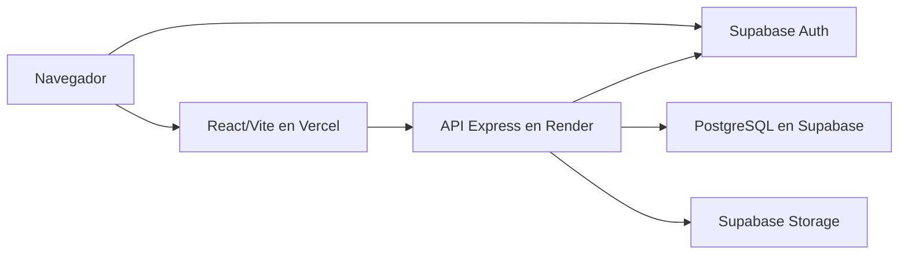
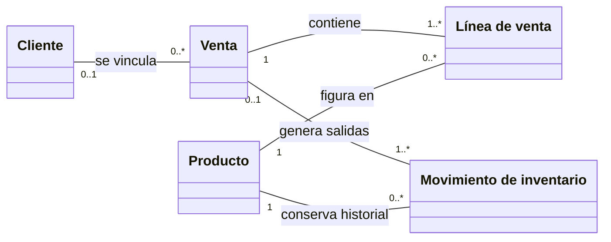
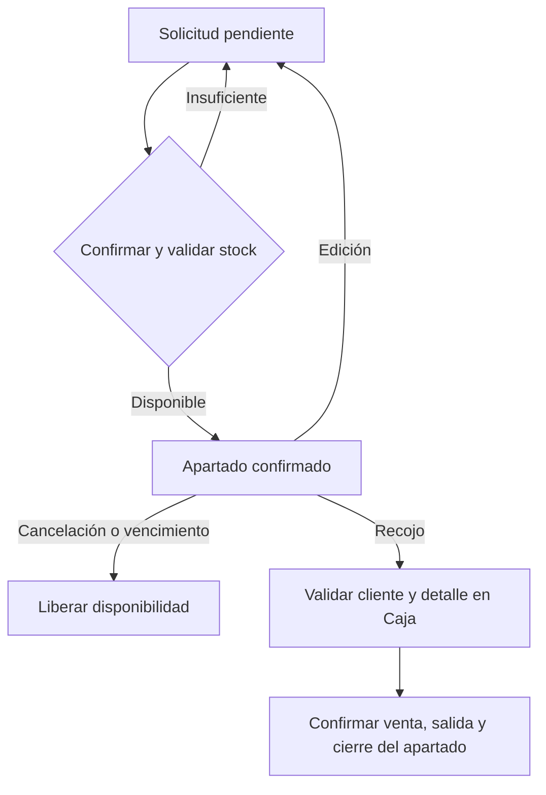
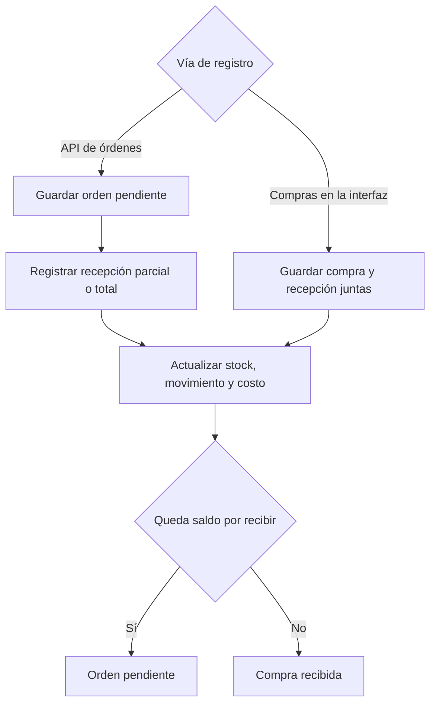

# Modelos de Comercial Nazareth V2

Los modelos describen los módulos, servicios y entidades del sistema. El modelo de clases representa las entidades del dominio y sus relaciones según el esquema y los servicios.

## Despliegue

El navegador inicia sesión en Supabase Auth. Express valida la identidad y el rol de cada operación protegida y usa PostgreSQL para las operaciones comerciales. El servicio de fotos usa Storage.

## Casos de uso por rol

Humberto Dávalos desempeña los roles de vendedor, administrador, responsable de almacén y responsable de compras con una sesión administrativa. El cliente registrado usa su propio perfil. [Diagrama editable](casos-de-uso.drawio) · [Detalle de casos de uso](../docs/CU.md).

## Clases del dominio

La venta sirve de punto de partida para leer el modelo. Cada venta guarda sus líneas con el producto, la cantidad y el precio aplicado. Al confirmarla, el sistema actualiza el stock y registra los movimientos de salida. El cliente se vincula si se identifica en Caja.

En compras, la orden indica qué se espera recibir y la recepción registra lo que entró al inventario. En reservas, la confirmación aparta unidades y el recojo enlaza la reserva con una venta. Estos recorridos se muestran en los flujos de esta página.

Modelo de dominio completo

El modelo agrupa entidades persistidas, sus atributos principales y sus relaciones. Las líneas de venta, de reserva y de orden guardan el detalle por producto. Consulta el [diagrama editable](clases.drawio), el [esquema comercial](../codigo/database/migrations/001_commercial_schema.sql), los [vínculos entre reservas y ventas](../codigo/database/migrations/005_full_scope.sql) y la [migración de beneficios](../codigo/database/migrations/013_loyalty_benefits.sql).

## Reserva y recojo

## CU-006 · Gestionar inventario

[Diagrama editable](actividad-gestionar-inventario.drawio) · [Proceso CU-006](../docs/proceso-critico.md)

## Compra y recepción

