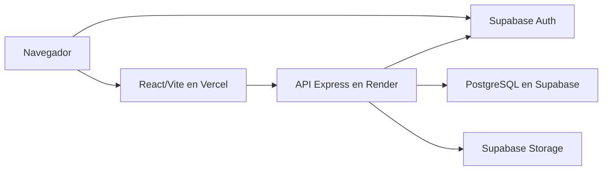
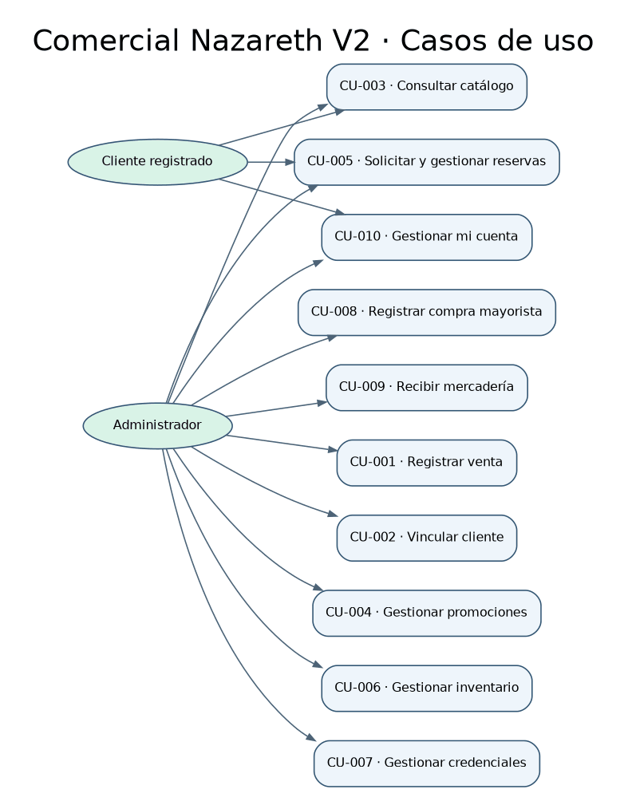
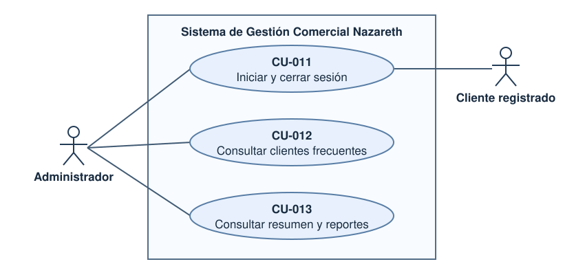
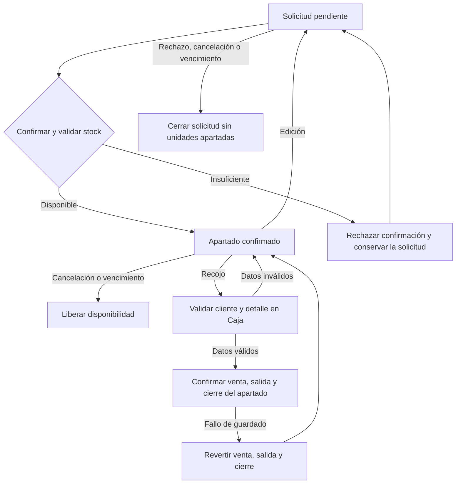
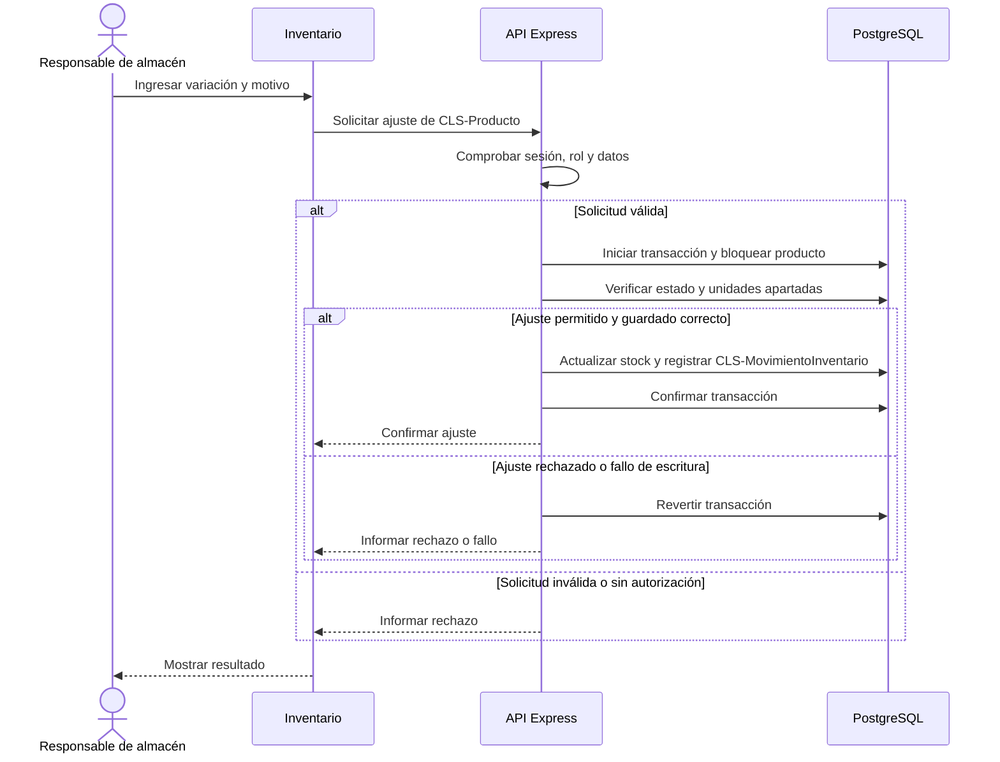
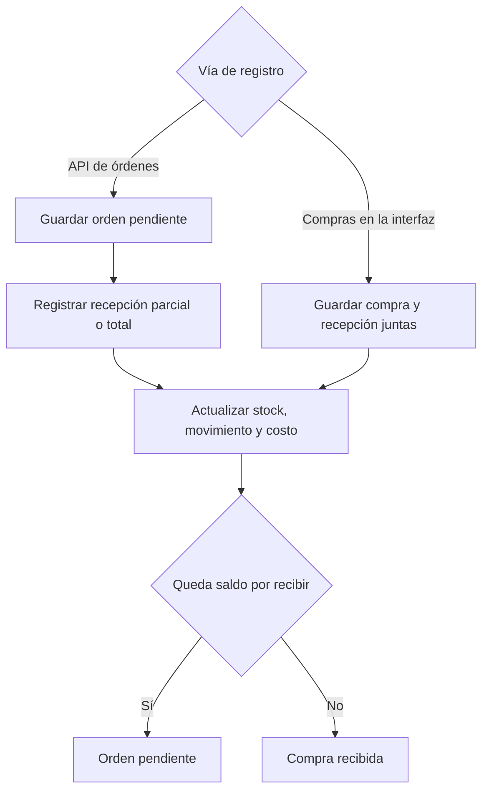

# Modelos de Comercial Nazareth V2

Los modelos describen los módulos, servicios y entidades del sistema. El modelo de clases representa las entidades del dominio y sus relaciones según el esquema y los servicios.

## Despliegue

El navegador inicia sesión en Supabase Auth. Express valida la identidad y el rol de cada operación protegida y usa PostgreSQL para las operaciones comerciales. El servicio de fotos usa Storage.

La aplicación web se publica en [Vercel](https://comercial-nazareth-codigo.vercel.app/) y la API Express se aloja en Render. La dirección de la API se configura en el frontend mediante `VITE_API_URL`; el backend limita los orígenes admitidos con `CLIENT_ORIGIN`. PostgreSQL conserva los registros comerciales, Supabase Auth administra la identidad y Storage almacena las fotos de productos.

El diagrama muestra la distribución del sistema y las conexiones entre servicios. La [guía técnica](../codigo/GUIA-TECNICA.md#despliegue-web) describe su configuración y el [informe de verificación](../reportes/verificacion-v2.md) registra las pruebas del sistema.

## Casos de uso por rol

Humberto Dávalos desempeña los roles de vendedor, administrador, responsable de almacén y responsable de compras con una sesión administrativa. El cliente registrado usa su propio perfil. El diagrama general reúne CU-001 a CU-013 dentro del límite del sistema, con los actores fuera de él. [Diagrama general editable](casos-de-uso.drawio) · [Detalle de los 13 casos de uso](../docs/CU.md).

### Sesión y consultas administrativas

[Diagrama editable de CU-011 a CU-013](casos-de-uso-sesion-consultas.drawio).

## Clases del dominio

[Diagrama editable en Draw.io](clases.drawio) · [PNG para el informe](clases.png) · [Esquema comercial](../codigo/database/migrations/001_commercial_schema.sql) · [Relación entre reservas y ventas](../codigo/database/migrations/005_full_scope.sql) · [Beneficios de fidelización](../codigo/database/migrations/013_loyalty_benefits.sql).

El diagrama reúne las 18 entidades principales del dominio. **Producto** conecta ventas, inventario, compras, reservas y catálogo. Las multiplicidades reflejan el esquema y las reglas de negocio, incluido el límite de una a tres líneas por reserva (RF-009). La dependencia de Venta hacia Promoción expresa el uso del precio vigente (BR-002). Las firmas tipadas representan responsabilidades del dominio realizadas por los servicios de Express.

La [matriz de trazabilidad](../matrices/trazabilidad.md#requisitos-funcionales) cita los identificadores `CLS-…` de la fuente editable. Las consultas de clientes y reportes se trazan a las entidades que aportan sus datos y a los servicios enlazados en [alcance y evidencia](../docs/alcance-y-evidencia.md).

El informe final (§4) y el diagrama del repositorio muestran 18 clases. `CLS-ProductoEnLista` representa la asociación entre una lista y un producto y se vincula con RF-007.

### Evolución del modelo

| Decisión | Modelo de v1.0 | Modelo V2 | Efecto |
|---|---|---|---|
| Separar categoría e historial de inventario | Producto concentraba la categoría como texto y las operaciones de stock. | `CLS-Categoria` agrupa productos y `CLS-MovimientoInventario` registra la variación y el historial. | Cada movimiento conserva el contexto del ajuste de RF-015. Producto sigue siendo el punto de enlace con ventas y compras. |
| Separar lista y favoritos | Una clase de lista usaba un tipo para distinguir los dos usos. | `CLS-ListaProductos`, `CLS-ProductoEnLista` y `CLS-Favorito` reflejan las estructuras de persistencia. | Las operaciones de RF-007 pueden conservar favoritos al limpiar Mi lista después de una reserva. |

La comparación usa el [modelo de v1.0](https://github.com/seckfly/Grupo_4_ISW_Comercial_Nazareth_Definitivo_V2/blob/v1.0/modelos/clases.drawio), el [modelo V2](clases.drawio) y las [pruebas de integración](../codigo/backend/test/sales.integration.test.js).

## Reserva y recojo

## CU-006 · Gestionar inventario

[Diagrama editable](actividad-gestionar-inventario.drawio) · [Fuente en XML](actividad-gestionar-inventario.xml) · [Proceso CU-006](../docs/proceso-critico.md)

El flujograma de inventario usa carriles para distinguir las tareas del operador de las validaciones y escrituras del sistema.

### Secuencia del ajuste manual

La secuencia relaciona `ajustarStock(delta, motivo)` y `registrarAjuste(delta, motivo)` del modelo con el [servicio de inventario](../codigo/backend/src/services/inventoryService.js) y PRU-016 a PRU-019.

## Compra y recepción

