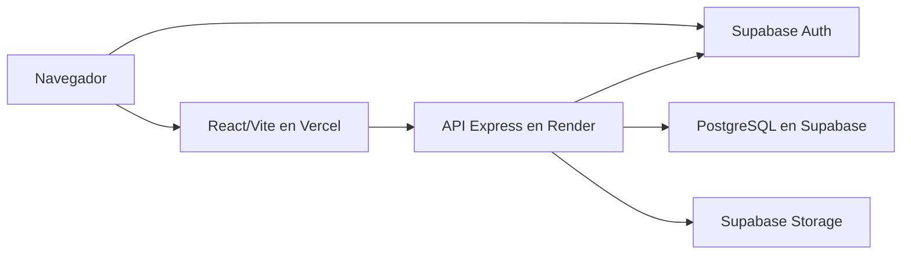
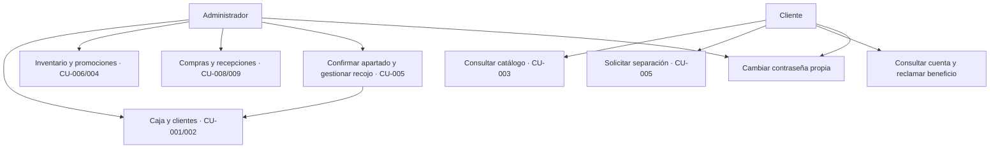
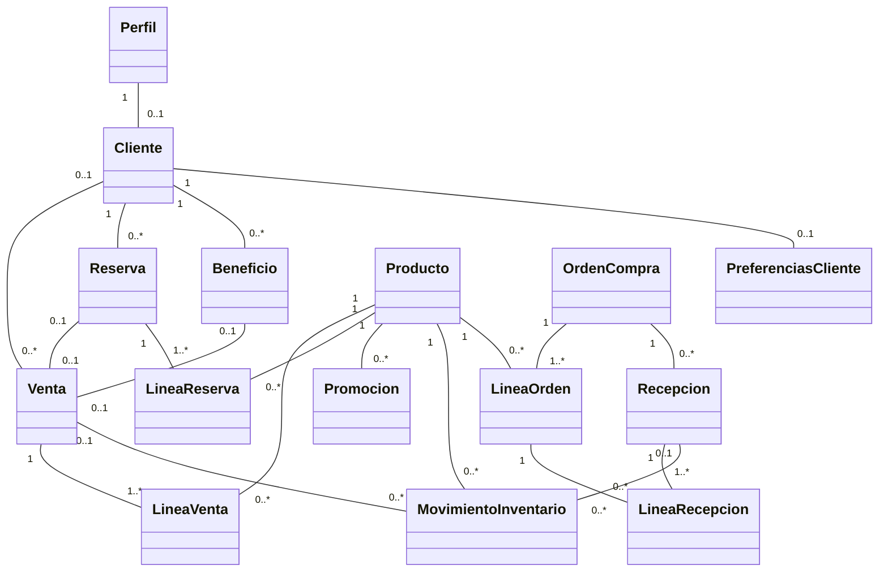
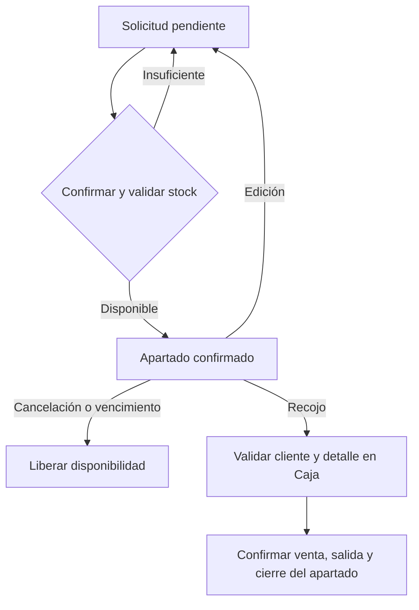
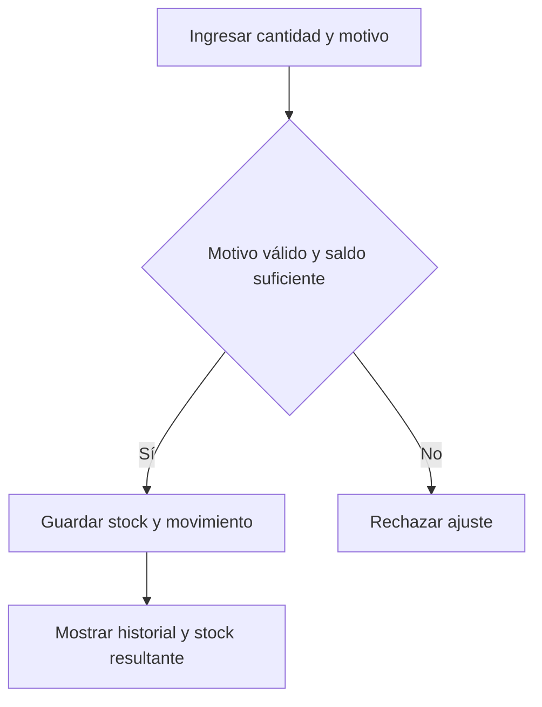
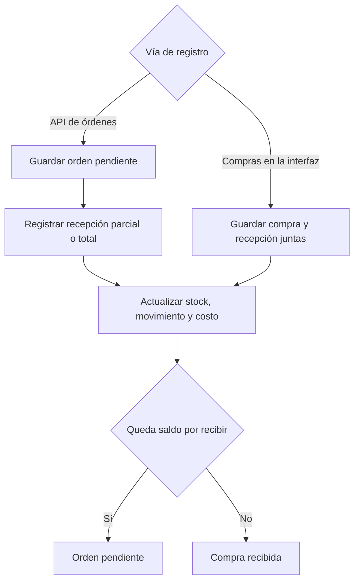

# Modelos de Comercial Nazareth V2

Los modelos describen los módulos, servicios y entidades del sistema. El modelo de clases representa las entidades del dominio y sus relaciones según el esquema y los servicios.

## Despliegue

El navegador inicia sesión en Supabase Auth. Express valida la identidad y el rol de cada operación protegida y usa PostgreSQL para las operaciones comerciales. El servicio de fotos usa Storage.

## Casos de uso por perfil

## Clases del dominio

## Reserva y recojo

## Ajuste de inventario

La validación del saldo protege las unidades apartadas. La alerta se calcula con el stock físico y el mínimo del producto activo.

## Compra y recepción

