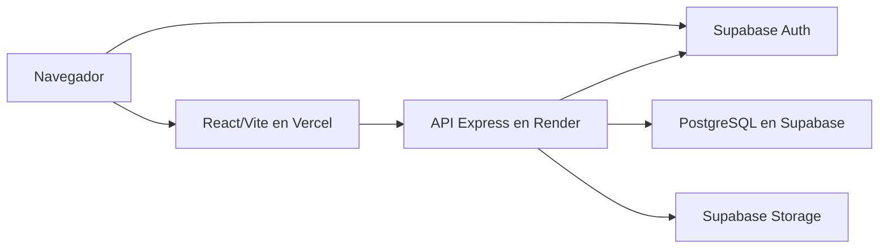
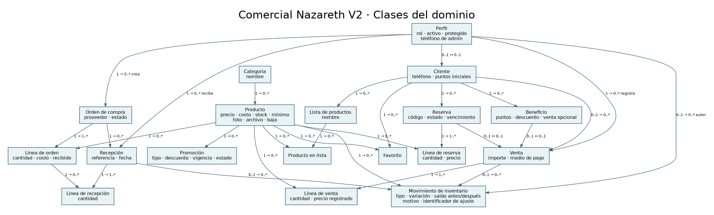
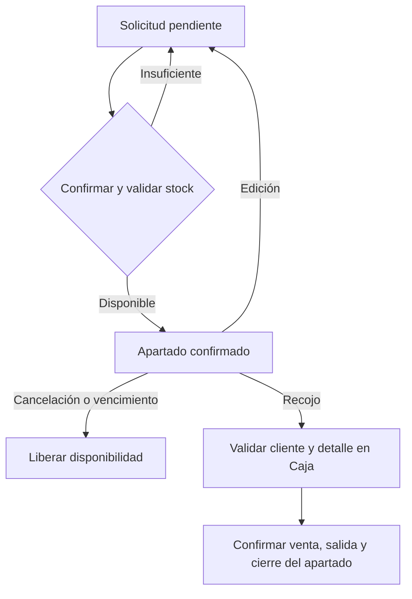
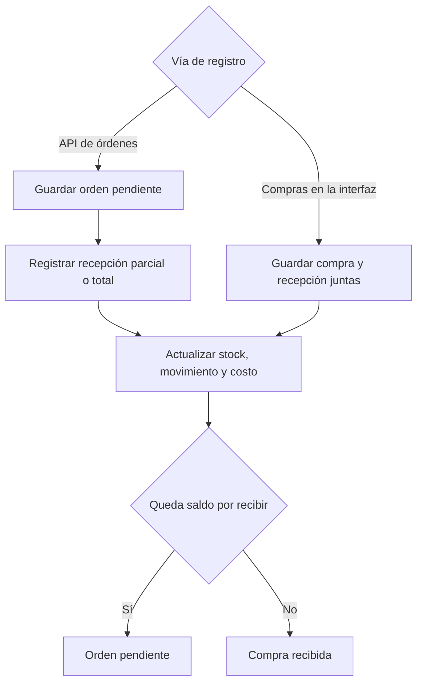

# Modelos de Comercial Nazareth V2

Los modelos describen los módulos, servicios y entidades del sistema. El modelo de clases representa las entidades del dominio y sus relaciones según el esquema y los servicios.

## Despliegue

El navegador inicia sesión en Supabase Auth. Express valida la identidad y el rol de cada operación protegida y usa PostgreSQL para las operaciones comerciales. El servicio de fotos usa Storage.

## Casos de uso por perfil

El administrador realiza ventas, inventario, compras, promociones y gestión de credenciales. El cliente consulta el catálogo, solicita o cancela su reserva y usa Mi cuenta. Ambos perfiles pueden gestionar su propia cuenta según sus permisos. [Detalle de casos de uso](../docs/CU.md).

## Clases del dominio

[Diagrama editable](clases.drawio). Las clases representan el dominio persistido. Las asociaciones se contrastaron con el [esquema comercial](../codigo/database/migrations/001_commercial_schema.sql), los vínculos de [reservas y ventas](../codigo/database/migrations/005_full_scope.sql) y la migración de [beneficios](../codigo/database/migrations/013_loyalty_benefits.sql).

## Reserva y recojo

## Gestionar inventario

[Diagrama editable](actividad-gestionar-inventario.drawio) · [Proceso CU-006](../docs/proceso-critico.md)

## Compra y recepción

